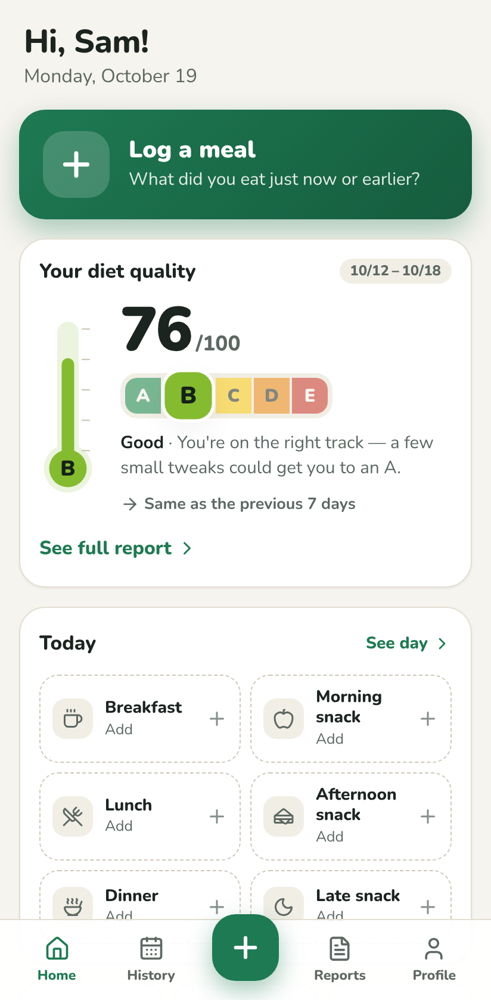
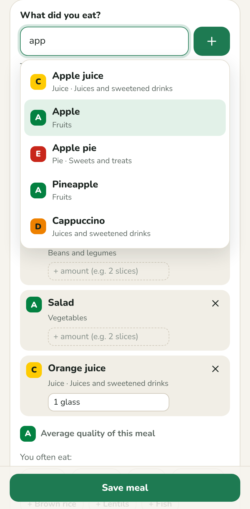
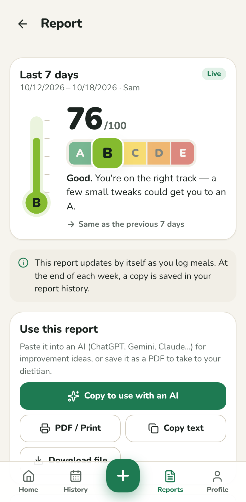
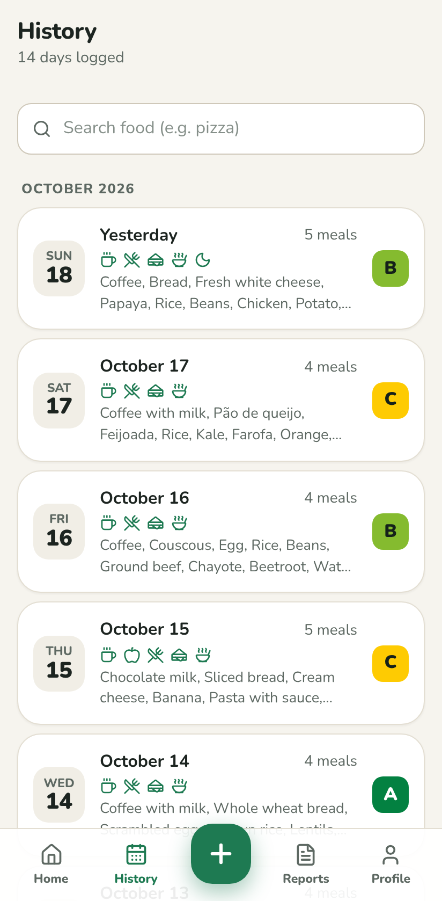

# EatMate 🥗

**Your simple food diary — no calorie counting.**

🌍 **English** · [Português](README.pt.md) · [Español](README.es.md) · [Deutsch](README.de.md) · [Français](README.fr.md) · [Italiano](README.it.md)

Write down what you ate the way you'd say it — _"a cup of coffee and two slices of toast"_ — and EatMate figures out the foods on its own. After 7 days a **thermometer** shows the quality of your diet as a grade from **A to E** (Nutri-Score style), plus a **full report** you can show your dietitian or paste into an AI (ChatGPT, Gemini, Claude…) to ask for tips.

## 👉 Open EatMate

### **[malonefreak.github.io/EatMate](https://malonefreak.github.io/EatMate/)**

Just open the link on your phone or computer. **Nothing to download from an app store, no account, no payment.** After the first visit it even works offline.

|                                               Home                                               |                                            Logging a meal                                            |                                   Report                                   |                                    History                                    |
| :----------------------------------------------------------------------------------------------: | :--------------------------------------------------------------------------------------------------: | :------------------------------------------------------------------------: | :---------------------------------------------------------------------------: |
|  |  |  |  |

## 📱 Add it to your home screen (optional)

That way EatMate opens with one tap, like any other app:

- **Android (Chrome):** open the link, tap the **⋮** menu and choose **Install app** (or **Add to Home screen**).
- **iPhone (Safari):** open the link, tap **Share** (the square with an arrow) and then **Add to Home Screen**.
- **Computer (Chrome or Edge):** click the install icon in the address bar.

You can also do it from inside the app, in **Profile → Install the app**.

## ✍️ How to use it

1. **Tell it what to call you.** That's it — no email, no password.
2. **Tap "Log a meal"** and write what you ate in your own words: _"chicken, rice, beans and a glass of orange juice"_. EatMate splits the foods, suggests as you type and shows each food's grade. Log right away or later, picking any past day.
3. **Made a mistake?** In **History** you can see every day and edit or delete any meal.
4. **After 7 days** of logging, the **thermometer** appears on the home screen with your score (0–100 and A–E).
5. **Tap the thermometer** to open the full report: what went well, what to watch, fruits and vegetables, ultra-processed foods, meal regularity and a diary of everything you ate. Use the buttons to **copy it for an AI**, **save it as a PDF** for your dietitian or **share** it on WhatsApp.
6. **Every week** the report is saved under **Reports**. Fixed a day afterwards? The report tells you it's out of date and you can generate it again with one tap.

Doesn't recognize a food? It asks once which category it belongs to and remembers it for next time.

## 🌍 Languages

EatMate speaks **Portuguese, English, Spanish, German, French and Italian**. It opens in your phone's language, and you can switch anytime in **Profile → Language**. The food names change too: in English it understands _"a cup of coffee and two slices of toast"_; in German, _"zwei Scheiben Vollkornbrot"_; in Spanish, _"un vaso de zumo de naranja"_.

## 🔒 Your data stays yours

- No sign-up, no server, no ads, no trackers.
- Everything you log is **stored only on your device**.
- A report only leaves your device when **you** copy, share or save it.
- Switching phones? In **Profile → Export backup** you save a file; on the new phone, tap **Restore a backup** on the welcome screen (or **Profile → Import backup**).

## 🌡️ How the grade is calculated

Each food has a grade from **A** (best) to **E**, inspired by the [Nutri-Score](https://www.santepubliquefrance.fr/en/nutri-score), and a degree of processing based on the [Dietary Guidelines for the Brazilian Population](https://www.gov.br/saude/pt-br/assuntos/saude-brasil/publicacoes-para-promocao-a-saude/guia_alimentar_populacao_brasileira_2ed.pdf) (unprocessed, processed and ultra-processed; the guide is in Portuguese). The weekly score combines:

| What counts                                      | Weight |
| ------------------------------------------------ | ------ |
| Quality of the foods (average of the A–E grades) | 40%    |
| Fewer ultra-processed foods, more real food      | 20%    |
| Fruits and vegetables (goal: 5 servings a day)   | 20%    |
| Variety of good-quality foods                    | 10%    |
| Regular breakfast, lunch and dinner              | 10%    |

**A** from 85 points, **B** from 70, **C** from 55, **D** from 40 and **E** below that.

> ⚠️ The grades are estimates to help you notice patterns. EatMate does not replace advice from a dietitian.

## ❓ FAQ

**Does it cost anything?** No, it's free.

**Do I need internet?** Only to open it for the first time (and to receive updates). After that it works offline.

**Is it a diet or calorie-counting app?** No. The idea is to notice the **quality** of what you eat over the week, without weighing food or counting calories.

**Will I lose my entries when the app updates?** No. An update only replaces the app; your entries stay on your device. Besides the browser's database, EatMate keeps an automatic backup copy of everything you log and restores anything that's missing when it opens.

**On iPhone, my entries disappeared after I added the app to my home screen.** iPhone keeps the data of Safari and the data of the home-screen app separate. Always use the same one (preferably the home-screen app). To move your entries from one to the other, use **Profile → Export backup** in one and **Import backup** in the other.

**I deleted the app / cleared my browser. Did I lose everything?** The data lives in your device's browser, so clearing the browser's data deletes your entries. That's why it's worth exporting a backup now and then (the app shows the date of the last one).

**How do I find out about a new version?** The app tells you by itself: "New version available" appears with an **Update** button. What's new in each version is listed under [Releases](https://github.com/MaloneFreak/EatMate/releases) and in the [changelog](CHANGELOG.md) (in Portuguese).

**I found a problem or have an idea.** Open an [issue](https://github.com/MaloneFreak/EatMate/issues) and tell me what happened.

## 🛠️ For developers

EatMate is a web app (PWA) built with React and TypeScript, with no server. How to run it on your computer, test it, publish it and create a new version is covered in [docs/DESENVOLVIMENTO.md](docs/DESENVOLVIMENTO.md) (in Portuguese).
