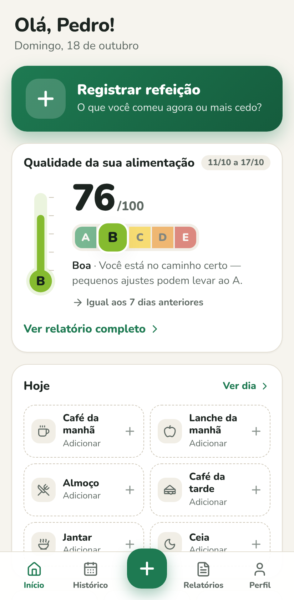
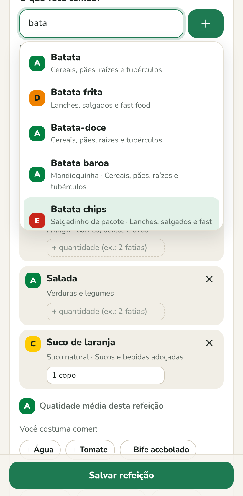
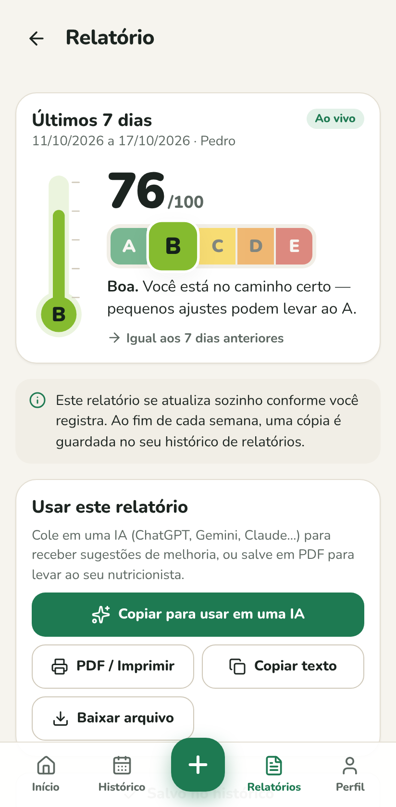
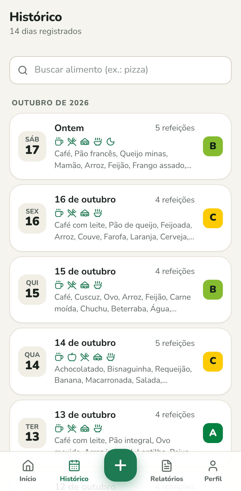

# EatMate 🥗

**Seu diário alimentar simples — sem contar calorias.**

🌍 **Português** · [English](README.en.md) · [Español](README.es.md) · [Deutsch](README.de.md) · [Français](README.fr.md) · [Italiano](README.it.md)

Anote o que você comeu do jeito que você fala — _"tomei café com leite e comi 2 torradas"_ — e o EatMate entende sozinho. Depois de 7 dias aparece um **termômetro** com a nota da sua alimentação, de **A a E** (no estilo do Nutri-Score), e um **relatório completo** para mostrar ao seu nutricionista ou colar em uma IA (ChatGPT, Gemini, Claude…) e pedir dicas.

## 👉 Abrir o EatMate

### **[malonefreak.github.io/EatMate](https://malonefreak.github.io/EatMate/)**

É só abrir o link no celular ou no computador. **Não precisa baixar nada da loja, criar conta nem pagar.** Depois da primeira vez, funciona até sem internet.

|                                         Início                                          |                                            Registro                                            |                                   Relatório                                    |                                   Histórico                                    |
| :-------------------------------------------------------------------------------------: | :--------------------------------------------------------------------------------------------: | :----------------------------------------------------------------------------: | :----------------------------------------------------------------------------: |
|  |  |  |  |

## 📱 Deixar na tela inicial do celular (opcional)

Assim o EatMate abre com um toque, como qualquer aplicativo:

- **Android (Chrome):** abra o link, toque no menu **⋮** e escolha **Instalar app** (ou **Adicionar à tela inicial**).
- **iPhone (Safari):** abra o link, toque em **Compartilhar** (o quadrado com a setinha) e depois em **Adicionar à Tela de Início**.
- **Computador (Chrome ou Edge):** clique no ícone de instalar que aparece na barra de endereço.

Também dá para fazer isso pelo próprio app, em **Perfil → Instalar o app**.

## ✍️ Como usar

1. **Diga como quer ser chamado.** Só isso — sem e-mail, sem senha.
2. **Toque em "Registrar refeição"** e escreva o que comeu, do seu jeito: _"arroz, feijão, bife acebolado e um copo de suco de laranja"_. O app separa os alimentos, sugere enquanto você digita e mostra a nota de cada um. Dá para registrar na hora ou depois, escolhendo outro dia.
3. **Errou alguma coisa?** No **Histórico** você vê cada dia e pode editar ou excluir qualquer refeição.
4. **Depois de 7 dias** com registro, o **termômetro** aparece na tela inicial com a sua nota (0 a 100 e A a E).
5. **Toque no termômetro** para ver o relatório completo: pontos positivos, pontos de atenção, frutas e verduras, ultraprocessados, regularidade das refeições e o diário de tudo o que você comeu. Use os botões para **copiar para uma IA**, **salvar em PDF** para o nutricionista ou **compartilhar** pelo WhatsApp.
6. **Toda semana** o relatório fica guardado em **Relatórios**. Corrigiu algum dia depois? O relatório avisa que está desatualizado e você gera de novo com um toque.

O app não conhece algum alimento? Ele pergunta uma vez em qual categoria ele entra e lembra para as próximas.

## 🌍 Idiomas

O EatMate fala **português, inglês, espanhol, alemão, francês e italiano**. Ele abre no idioma do seu celular, e você pode trocar quando quiser em **Perfil → Idioma**. Os nomes dos alimentos também mudam: em inglês ele entende _"a cup of coffee and two slices of toast"_; em alemão, _"zwei Scheiben Vollkornbrot"_; em espanhol, _"un vaso de zumo de naranja"_.

## 🔒 Seus dados são só seus

- Não tem cadastro, servidor, propaganda nem rastreador.
- Tudo o que você registra fica **guardado só no seu aparelho**.
- O relatório só sai do aparelho quando **você** copia, compartilha ou salva.
- Vai trocar de celular? Em **Perfil → Exportar backup** você salva um arquivo; no celular novo, toque em **Restaurar backup** na tela de boas-vindas (ou em **Perfil → Importar backup**).

## 🌡️ Como a nota é calculada

Cada alimento tem uma nota de **A** (melhor) a **E**, inspirada no [Nutri-Score](https://www.santepubliquefrance.fr/en/nutri-score), e um grau de processamento segundo o [Guia Alimentar para a População Brasileira](https://www.gov.br/saude/pt-br/assuntos/saude-brasil/publicacoes-para-promocao-a-saude/guia_alimentar_populacao_brasileira_2ed.pdf) (in natura, processados e ultraprocessados). A nota da semana combina:

| O que conta                                          | Peso |
| ---------------------------------------------------- | ---- |
| Qualidade dos alimentos (média das notas A–E)        | 40%  |
| Menos ultraprocessados, mais comida de verdade       | 20%  |
| Frutas, verduras e legumes (meta: 5 porções por dia) | 20%  |
| Variedade de alimentos bons                          | 10%  |
| Café da manhã, almoço e jantar com regularidade      | 10%  |

**A** a partir de 85 pontos, **B** a partir de 70, **C** a partir de 55, **D** a partir de 40 e **E** abaixo disso.

> ⚠️ As notas são estimativas para ajudar você a perceber padrões. O EatMate não substitui a orientação de um(a) nutricionista.

## ❓ Perguntas frequentes

**É pago?** Não, é gratuito.

**Precisa de internet?** Só para abrir pela primeira vez (e para receber atualizações). Depois funciona offline.

**É um app de dieta ou de contar calorias?** Não. A ideia é perceber a **qualidade** do que você come ao longo da semana, sem pesar comida nem contar calorias.

**Apaguei o app / limpei o navegador. Perdi tudo?** Os dados ficam no navegador do aparelho, então limpar os dados do navegador apaga os registros. Por isso vale exportar um backup de vez em quando (o app mostra a data do último).

**Como fico sabendo de uma versão nova?** O app avisa sozinho: aparece "Nova versão disponível" com o botão **Atualizar**. As novidades de cada versão ficam em [Releases](https://github.com/MaloneFreak/EatMate/releases) e no [histórico de mudanças](CHANGELOG.md).

**Encontrei um problema ou tenho uma ideia.** Abra uma [issue](https://github.com/MaloneFreak/EatMate/issues) contando o que aconteceu.

## 🛠️ Para quem desenvolve

O EatMate é um app web (PWA) feito com React e TypeScript, sem servidor. Como rodar no computador, testar, publicar e criar uma nova versão está em [docs/DESENVOLVIMENTO.md](docs/DESENVOLVIMENTO.md).
